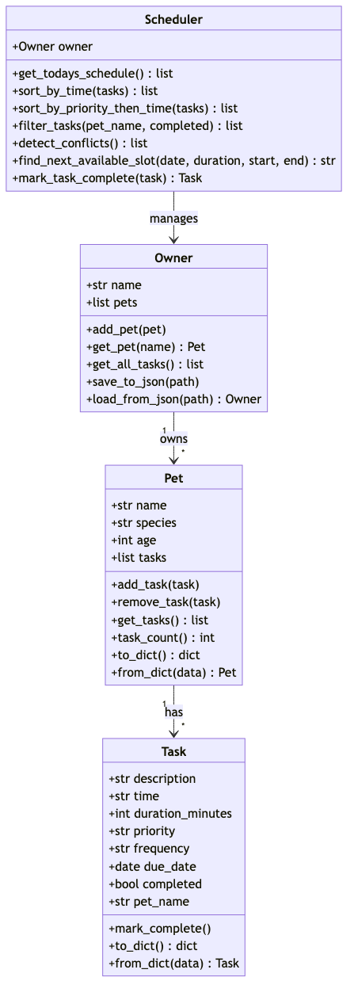

# PawPal+ (Module 2 Project)

**PawPal+** is a pet care scheduling app built with Python and Streamlit. It helps pet owners plan daily care tasks across multiple pets, with sorting, filtering, conflict detection, and recurring task support.

## Features

- Add multiple pets with name, species, and age
- Schedule care tasks with time, duration, priority, and frequency
- View today's schedule sorted chronologically
- Filter tasks by pet or completion status
- Detect scheduling conflicts (same time on same date)
- Recurring tasks: daily and weekly tasks auto-generate their next instance on completion
- Streamlit web UI with interactive controls
- CLI demo script for quick testing

## Classes

- **Task** (dataclass): description, time, duration, priority, frequency, due_date, completed, pet_name. Method: `mark_complete()`.
- **Pet** (dataclass): name, species, age, tasks. Methods: `add_task()`, `remove_task()`, `get_tasks()`, `task_count()`.
- **Owner**: name, pets. Methods: `add_pet()`, `get_pet()`, `get_all_tasks()`.
- **Scheduler**: owner. Methods: `get_todays_schedule()`, `sort_by_time()`, `filter_tasks()`, `detect_conflicts()`, `mark_task_complete()`.

## UML Diagram



The Mermaid source is at `diagrams/uml_final.mmd`.

## Setup

```bash
python -m venv .venv
source .venv/bin/activate  # Windows: .venv\Scripts\activate
pip install -r requirements.txt
```

## How to Run

**CLI demo:**

```bash
python main.py
```

**Streamlit app:**

```bash
streamlit run app.py
```

**Tests:**

```bash
python -m pytest tests/test_pawpal.py -v
```

## Sample Output

Output from `python main.py`:

```
=== Today's Schedule for Andres (2026-10-25) ===

  07:30 - Feed breakfast (Whiskers, 10 min) [priority: high] [Pending]
  08:00 - Morning walk (Buddy, 30 min) [priority: high] [Pending]
  09:00 - Flea medication (Buddy, 5 min) [priority: high] [Pending]
  09:00 - Play session (Whiskers, 15 min) [priority: low] [Pending]
  12:00 - Litter box clean (Whiskers, 10 min) [priority: medium] [Pending]
  17:00 - Evening walk (Buddy, 30 min) [priority: medium] [Pending]

=== Buddy's Tasks ===

  17:00 - Evening walk [medium]
  08:00 - Morning walk [high]
  09:00 - Flea medication [high]

=== Incomplete Tasks Only ===

  17:00 - Evening walk (Buddy) [medium]
  08:00 - Morning walk (Buddy) [high]
  09:00 - Flea medication (Buddy) [high]
  07:30 - Feed breakfast (Whiskers) [high]
  12:00 - Litter box clean (Whiskers) [medium]
  09:00 - Play session (Whiskers) [low]

=== Marking 'Morning walk' as complete ===
  Completed: Morning walk on 2026-10-25
  Next instance created: Morning walk on 2026-10-26

=== Conflict Warnings ===

  ⚠ Conflict: 'Play session' (Whiskers) and 'Flea medication' (Buddy) are both at 09:00 on 2026-10-25
```

## Testing PawPal+

```bash
python -m pytest tests/test_pawpal.py -v
```

**What's covered:** task completion, task counting, chronological sorting, daily/weekly/once recurrence, conflict detection (true and false positives), filtering by pet and status, and edge cases (empty pets, empty owners, empty schedules).

```
tests/test_pawpal.py::test_mark_complete_flips_status PASSED             [  7%]
tests/test_pawpal.py::test_add_task_increases_count PASSED               [ 15%]
tests/test_pawpal.py::test_sort_by_time_chronological PASSED             [ 23%]
tests/test_pawpal.py::test_recurrence_daily_creates_next_day PASSED      [ 30%]
tests/test_pawpal.py::test_recurrence_weekly_creates_next_week PASSED    [ 38%]
tests/test_pawpal.py::test_recurrence_once_does_not_recur PASSED         [ 46%]
tests/test_pawpal.py::test_conflict_detection_same_time PASSED           [ 53%]
tests/test_pawpal.py::test_conflict_detection_no_false_positive PASSED   [ 61%]
tests/test_pawpal.py::test_filter_by_pet PASSED                          [ 69%]
tests/test_pawpal.py::test_filter_by_status PASSED                       [ 76%]
tests/test_pawpal.py::test_pet_with_no_tasks PASSED                      [ 84%]
tests/test_pawpal.py::test_owner_with_no_pets PASSED                     [ 92%]
tests/test_pawpal.py::test_empty_schedule PASSED                         [100%]

13 passed in 0.02s
```

**Confidence Level:** ⭐⭐⭐⭐ (4/5) -- All core behaviors are tested including edge cases. The one gap is that I don't test duration-based overlap since the conflict detector only checks exact time matches.

## Smarter Scheduling

| Feature | Method(s) | Notes |
|---------|-----------|-------|
| Task sorting | `Scheduler.sort_by_time()` | Sorts tasks chronologically by parsing "HH:MM" into total minutes for comparison. |
| Filtering | `Scheduler.filter_tasks()` | Filters tasks by pet name and/or completion status across all pets. |
| Conflict handling | `Scheduler.detect_conflicts()` | Flags tasks that share the same date and time, even across different pets. |
| Recurring tasks | `Scheduler.mark_task_complete()` | Marks a task done and auto-creates the next instance for daily (+1 day) or weekly (+7 days) tasks. |

## JSON Persistence

PawPal+ saves all data to `data.json` automatically. When you add a pet, add a task, or mark a task complete in the Streamlit app, the owner/pet/task data is written to disk. On the next app launch, it loads from `data.json` if the file exists.

- **Methods:** `Owner.save_to_json(path)` and `Owner.load_from_json(path)` with custom `to_dict()`/`from_dict()` on Task and Pet.
- **Files modified:** `pawpal_system.py` (added serialization methods), `app.py` (load on startup, save after mutations), `.gitignore` (excludes `data.json`).
- **Date handling:** `due_date` is stored as an ISO string (`"2026-10-25"`) and parsed back with `date.fromisoformat()`.

## Demo Walkthrough

1. **Add pets:** Enter a pet name, species, and age, then click "Add Pet." The app supports multiple pets (e.g., a dog named Buddy and a cat named Whiskers).
2. **Schedule tasks:** Select which pet a task is for, enter the description, time (HH:MM), duration, priority, and frequency (once/daily/weekly). Click "Add Task."
3. **View today's schedule:** The schedule table shows all tasks sorted by time, with columns for time, description, pet, duration, priority, frequency, and status.
4. **Filter tasks:** Use the dropdowns to filter by a specific pet or by status (Pending/Completed/All).
5. **Mark a task complete:** Select a pending task from the dropdown and click "Mark Complete." If the task is daily or weekly, a new instance is automatically created for the next due date. A confirmation message shows the recurrence info.
6. **Conflict warnings:** If two tasks (same pet or different pets) share the same time and date, a warning banner appears at the bottom of the schedule.

**CLI demo output** (from `python main.py`):

```
=== Today's Schedule for Andres (2026-10-25) ===

  07:30 - Feed breakfast (Whiskers, 10 min) [priority: high] [Pending]
  08:00 - Morning walk (Buddy, 30 min) [priority: high] [Pending]
  09:00 - Flea medication (Buddy, 5 min) [priority: high] [Pending]
  09:00 - Play session (Whiskers, 15 min) [priority: low] [Pending]
  12:00 - Litter box clean (Whiskers, 10 min) [priority: medium] [Pending]
  17:00 - Evening walk (Buddy, 30 min) [priority: medium] [Pending]

=== Marking 'Morning walk' as complete ===
  Completed: Morning walk on 2026-10-25
  Next instance created: Morning walk on 2026-10-26

=== Conflict Warnings ===

  ⚠ Conflict: 'Play session' (Whiskers) and 'Flea medication' (Buddy) are both at 09:00 on 2026-10-25
```
